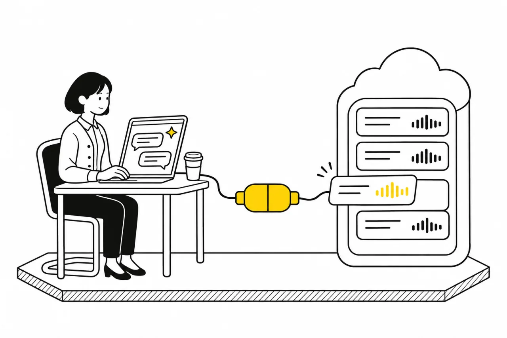

[English](README.md) | [한국어](README.ko.md) | 日本語

# Minu MCP

<p align="center"></p>

**いつもの AI アシスタントに、自分の会議を聞いてみましょう。** AI 議事録サービス [Minu](https://minu.page) につなぐと、作業中の画面のまま会議の一覧、文字起こし、議事録を読み込めます。

- 「先週の会議で決まったことは?」
- 「最後の会議の議事録を読んで、やることをチェックリストにして。」
- 「自分の業務に合う Minu プリセットを作って。」

AI アシスタントは読むことと、プリセットを作ることができます。会議を編集したり削除したりはできません。

> **公開状況。** Minu MCP はまだすべての方には公開されていません。ログイン画面で利用できないと表示されたら、しばらくしてからもう一度お試しください。

## できること

接続すると、AI アシスタントはあなたの Minu アカウントで 5 つのツールを使えます。

| ツール | 内容 |
| --- | --- |
| `list_meetings` | 会議を新しい順に一覧します。キーワード、日付、プリセットで絞り込めます。 |
| `get_meeting` | 会議 1 件の文字起こしを読みます。 |
| `get_meeting_minutes` | 会議 1 件の AI 議事録を、指定した言語で読みます。 |
| `list_presets` | 会議プリセットを一覧します。 |
| `create_preset` | テーマ、分野、専門用語から会議プリセットを作ります。1 時間に 10 件までです。 |

AI アシスタントは、会議、文字起こし、議事録を変更・削除できません。

## 必要なもの

- 有料プラン（**Pro** または **Pro Plus**）の Minu アカウント。Free プランでは接続されず、案内画面が表示されます。
- 次のクライアントのいずれか。

| クライアント | 確認済みバージョン |
| --- | --- |
| Claude Code | 2.1.325 |
| Codex CLI | 0.167.0 |

ほかの MCP クライアントはまだ確認していません。

サーバーのアドレス:

```
https://api.minu.page/v1/mcp
```

## Claude Code を接続する

1. プロジェクトのフォルダーでサーバーを追加します。

   ```bash
   claude mcp add --transport http --scope project minu "https://api.minu.page/v1/mcp"
   ```

2. そのフォルダーで `claude` を起動し、新しいサーバーを使うか聞かれたら承認します。
3. `/mcp` と入力し、`minu` を選び、`Authenticate` を選びます。
4. ブラウザーで Minu のログイン画面が開きます。Minu の画面は現在、韓国語で表示されます。ログインし、同意画面でアプリ名を確認して「허용」（許可）を押します。claude.ai や chatgpt.com など、アプリ提供元のアドレスが表示されることがありますが、問題ありません。Minu のウェブに初めてログインするときは、同意画面の前に案内画面が一度表示されます。「동의하고 계속하기」（同意して続ける）を押します。
5. Claude Code に `Authentication successful. Connected to minu.` と表示されます。[試してみる](#試してみる)のように依頼してみてください。

## Codex CLI を接続する

1. サーバーを追加します。Codex がそのままログインを始めます。

   ```bash
   codex mcp add minu --url https://api.minu.page/v1/mcp
   ```

2. ブラウザーで Minu のログイン画面が開きます。Minu の画面は現在、韓国語で表示されます。ログインし、同意画面でアプリ名を確認して「허용」（許可）を押します。claude.ai や chatgpt.com など、アプリ提供元のアドレスが表示されることがありますが、問題ありません。Minu のウェブに初めてログインするときは、同意画面の前に案内画面が一度表示されます。「동의하고 계속하기」（同意して続ける）を押します。
3. Codex に `Successfully logged in.` と表示されます。[試してみる](#試してみる)のように依頼してみてください。

あとでもう一度ログインするとき:

```bash
codex mcp login minu
```

## 試してみる

- 「今週の Minu の会議を一覧して。」
- 「直近の会議の議事録を読んで、やることをチェックリストにして。」
- 「自分の業務に合った Minu プリセットを作って。」AI アシスタントが先に分野と用語を尋ねることがあります。提案された内容を確認し、クライアントがツールの実行を確認してきたら承認します。

## 接続を解除する

**Claude Code の場合:** `/mcp` と入力し、`minu` を選び、`Clear authentication` を選びます。Minu 側の接続も一緒に解除されます。プロジェクトからサーバーを削除するには:

```bash
claude mcp remove --scope project minu
```

**Codex CLI の場合:**

```bash
codex mcp logout minu
codex mcp remove minu
```

Codex はこのコンピューターのログイン情報だけを削除します。Minu 側の接続は期限が切れるまで残ります。最後に使ってから最長 30 日です。

**Minu 側で解除する場合:** Minu 側の接続を解除するには、ウェブ版 Minu の設定で「회의록 연결」（議事録の連携）を開き、「연결된 AI 앱」（接続済みの AI アプリ）で「연결 끊기」（接続を解除）を押します。どちらのクライアントでも使えます。この欄は、接続があるときだけ表示されます。

## うまくいかないとき

| 表示 | 対処 |
| --- | --- |
| ログイン画面で Minu MCP を利用できないと表示される | Minu MCP はまだすべての方には公開されていません。しばらくしてからもう一度お試しください。 |
| ログイン後にプランの案内が出る、または AI アシスタントが Pro プランが必要と言う | Minu MCP は有料プランで利用できます。Minu アプリでアップグレードしてください。 |
| AI アシスタントが再ログインを求める、または `Authentication required` と表示される | Claude Code は `/mcp`、`minu`、`Authenticate`。Codex CLI は `codex mcp login minu`。接続を解除したあとにも表示されます。 |
| `create_preset` が拒否される | プリセットは 1 時間に 10 件まで作成できます。時間をおいてお試しください。 |

## ヘルプ

Minu ウェブサイト: [minu.page](https://minu.page)
