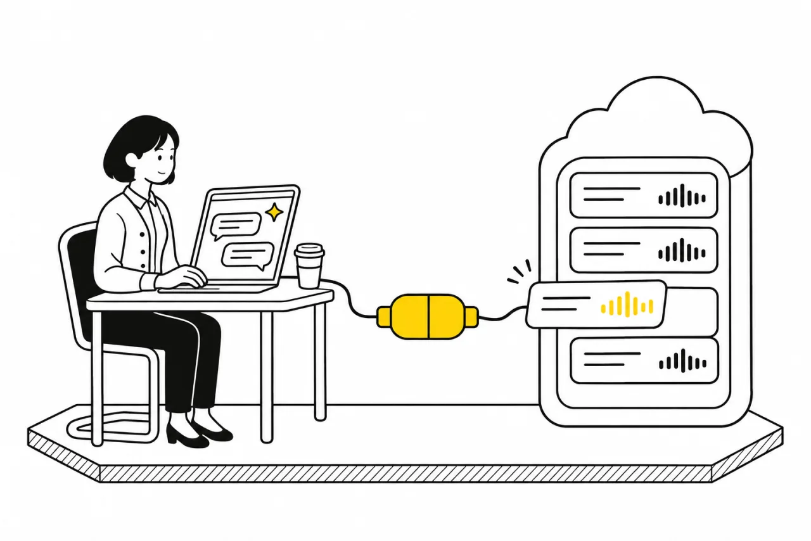

[English](README.md) | 한국어 | [日本語](README.ja.md) | [ไทย](README.th.md)

# Minu MCP

<p align="center"></p>

**쓰던 AI 도우미에서 내 회의를 물어보세요.** AI 회의록 서비스 [Minu](https://minu.page)에 연결하면, 일하던 자리에서 회의 목록, 대화 기록, 회의록을 읽어 와요.

- "지난주 회의에서 정한 일이 뭐였지?"
- "마지막 회의의 회의록을 읽고 할 일을 체크리스트로 만들어 줘."
- "내 업무에 맞는 Minu 프리셋을 만들어 줘."

AI 도우미는 읽고, 프리셋을 만들 수 있어요. 회의를 고치거나 지울 수는 없어요.

> **상태.** Minu MCP는 아직 모두에게 열리지 않았어요. 로그인 화면에 쓸 수 없다고 나오면 나중에 다시 해 보세요.

## 할 수 있는 일

연결하면 AI 도우미가 내 Minu 계정에서 다섯 가지 도구를 써요.

| 도구 | 하는 일 |
| --- | --- |
| `list_meetings` | 내 회의를 최근 순으로 보여 줘요. 단어, 날짜, 프리셋으로 걸러 볼 수 있어요. |
| `get_meeting` | 회의 하나의 대화 기록을 읽어요. |
| `get_meeting_minutes` | 회의 하나의 AI 회의록을 원하는 언어로 읽어요. |
| `list_presets` | 내 회의 프리셋을 보여 줘요. |
| `create_preset` | 내 업무를 짧게 적은 프로필로 프리셋 초안 두 개(일반 회의용, 통역 회의용)를 보여 주고, 승인한 것만 저장해요. 한 시간에 10개까지예요. |

AI 도우미는 회의, 대화 기록, 회의록을 고치거나 지울 수 없어요.

## 필요한 것

- 유료 플랜(**Pro** 또는 **Pro Plus**)의 Minu 계정. Free 플랜이면 연결되지 않고 플랜 안내 화면이 나와요. 그 화면에서 앱으로 돌아가면 클라이언트에는 `access_denied`만 보일 수 있어요. Minu는 이유("Minu MCP needs a Pro or Pro Plus plan. Upgrade in the Minu app.")도 함께 보내지만, 이를 보여 주지 않는 클라이언트도 있어요.
- 아래 클라이언트 중 하나.

| 클라이언트 | 확인한 버전 |
| --- | --- |
| Claude Code | 2.1.325 |
| Codex CLI | 0.167.0 |

다른 MCP 클라이언트는 아직 확인하지 않았어요.

서버 주소:

```
https://api.minu.page/v1/mcp
```

## Claude Code 연결하기

1. 프로젝트 폴더에서 서버를 추가해요.

   ```bash
   claude mcp add --transport http --scope project minu "https://api.minu.page/v1/mcp"
   ```

2. 그 폴더에서 `claude`를 실행해요. 질문 두 개가 차례로 나와요. Enter만 누르면 기본값이 골라져 Claude Code가 끝나거나 Minu 없이 시작하니, 방향키로 골라요.
   - 폴더를 믿을지 물으면 `Yes, I trust this folder`
   - 새 MCP 서버를 쓸지 물으면 `Use this MCP server`
3. `/mcp`를 입력하고 `minu`를 고른 뒤 `Authenticate`를 골라요. 브라우저가 열리지 않으면 `c`를 눌러 로그인 주소를 복사하고 브라우저에 붙여 넣어요. 화면의 주소를 손으로 복사하면 줄이 바뀐 곳에서 주소가 깨질 수 있어요.
4. 브라우저에 Minu 로그인 화면이 열려요. 로그인하고, 동의 화면에서 앱 이름을 확인한 뒤 허용을 눌러요. claude.ai나 chatgpt.com 같은 앱 제작사 주소가 함께 보일 수 있어요. 정상이에요. Minu 웹에 처음 로그인할 때는 동의 화면 전에 안내 화면이 한 번 나와요. 동의하고 계속하기를 눌러요.
5. Claude Code에 `Authentication successful. Connected to minu.`가 보여요. [써 보기](#써-보기)의 요청을 해 보세요.

## Codex CLI 연결하기

1. 서버를 추가해요. Codex가 로그인을 바로 시작해요.

   ```bash
   codex mcp add minu --url https://api.minu.page/v1/mcp
   ```

2. 브라우저에 Minu 로그인 화면이 열려요. 로그인하고, 동의 화면에서 앱 이름을 확인한 뒤 허용을 눌러요. claude.ai나 chatgpt.com 같은 앱 제작사 주소가 함께 보일 수 있어요. 정상이에요. Minu 웹에 처음 로그인할 때는 동의 화면 전에 안내 화면이 한 번 나와요. 동의하고 계속하기를 눌러요. 거부를 누르거나 지금 플랜에서 Minu MCP를 쓸 수 없으면 Codex가 같은 화면을 한 번 더 열어요. 다시 거부를 누르거나 창을 닫아요.
3. Codex에 `Successfully logged in.`이 보여요. [써 보기](#써-보기)의 요청을 해 보세요.

나중에 다시 로그인할 때:

```bash
codex mcp login minu
```

## 써 보기

- "이번 주 Minu 회의 목록을 보여 줘."
- "마지막 회의의 회의록을 읽고 할 일을 체크리스트로 만들어 줘."
- "내 업무에 맞는 Minu 프리셋을 만들어 줘." AI 도우미가 먼저 분야와 용어를 물을 수 있어요. 그다음 프리셋 초안 두 개(일반 회의용, 통역 회의용)를 보여 주고, 아직 아무것도 저장하지 않아요. 이름이 같은 프리셋을 바꿔 쓰게 되면 초안에 그 프리셋이 적혀 있어요. 초안을 읽고 저장하라고 답하거나, 고칠 곳을 알려 주세요. Minu는 승인한 내용만 저장해요. 키, 이메일 주소, 전화번호, 사람 이름은 빼 주세요. 앞의 셋은 Minu가 거절하고, 이름은 Minu가 알아내지 못해요. 클라이언트가 도구 실행을 물으면 승인해요.

## 연결 끊기

**Claude Code.** `/mcp`를 입력하고 `minu`를 고른 뒤 방향키로 세 번째 항목 `Clear authentication`을 골라요. Minu 쪽 연결도 함께 끊겨요. 프로젝트에서 서버를 지우려면:

```bash
claude mcp remove --scope project minu
```

**Codex CLI.**

```bash
codex mcp logout minu
codex mcp remove minu
```

이 두 명령은 이 컴퓨터의 로그인 정보만 지워요. Minu 쪽 연결은 끊기지 않고, 마지막으로 쓴 뒤 최대 30일까지 남아요. 바로 끊으려면 아래 **Minu에서 끊기**도 해요.

**Minu에서 끊기.** Minu 쪽 연결을 끊으려면 Minu 웹의 설정에서 회의록 연결로 들어가, 연결된 AI 앱에서 연결 끊기를 눌러요. 두 클라이언트 모두 이렇게 끊을 수 있어요. 연결이 있을 때만 이 구역이 보여요.

## 안 될 때

| 보이는 것 | 할 일 |
| --- | --- |
| 로그인 화면에 Minu MCP를 쓸 수 없다고 나옴 | Minu MCP는 아직 모두에게 열리지 않았어요. 나중에 다시 해 보세요. |
| 로그인 뒤 플랜 안내가 나오거나, AI 도우미가 Pro 플랜이 필요하다고 함 | Minu MCP는 유료 플랜에서 쓸 수 있어요. Minu 앱에서 업그레이드해 주세요. |
| `OAuth error: access_denied`가 나옴 | 거부를 눌렀거나 지금 플랜에서 Minu MCP를 쓸 수 없어요. 이유를 보여 주는 클라이언트에는 "Minu MCP needs a Pro or Pro Plus plan. Upgrade in the Minu app."가 함께 나와요. 연결하려면 다시 로그인해 허용을 눌러요. Free 플랜이면 먼저 Minu 앱에서 업그레이드해 주세요. |
| AI 도우미가 다시 로그인하라고 하거나 `Authentication required`라고 함 | Claude Code는 `/mcp`, `minu`, `Authenticate`. Codex CLI는 `codex mcp login minu`. 연결을 끊은 뒤에도 이렇게 나와요. |
| `create_preset`이 거절됨 | 프리셋은 한 시간에 10개까지 만들 수 있어요. 나중에 다시 해 보세요. 프로필에 키, 이메일 주소, 전화번호가 있거나 승인한 뒤 프로필이 바뀌어도 거절돼요. 개인 정보를 빼거나, 새 초안을 받아 다시 승인해 주세요. |

## 도움말

Minu 홈페이지: [minu.page](https://minu.page)

## 만든 곳

Minu는 [ClawPod](https://www.clawpod.cloud/)를 만드는 원더무브가 만들어요. ClawPod는 AI 직원으로 팀을 만들어 일을 맡기고, 결과와 근거로 확인하는 서비스예요. ClawPod로 만든 팀도 있어요.

- [세일즈포스 유지보수·운영 AI 팀](https://www.clawpod.cloud/salesforce-operations): 증상 뒤의 원인을 조사하고 복구 검증까지 해요.
- [AI 보안관제 팀](https://www.clawpod.cloud/security-operations): 이미 있는 보안 장비의 로그로 365일 24시간 관제해요.
- [Lance 취약점 점검·모의해킹](https://www.clawpod.cloud/penetration-testing): 공격자의 관점에서 약점을 찾고 증거로 보여 줘요.
