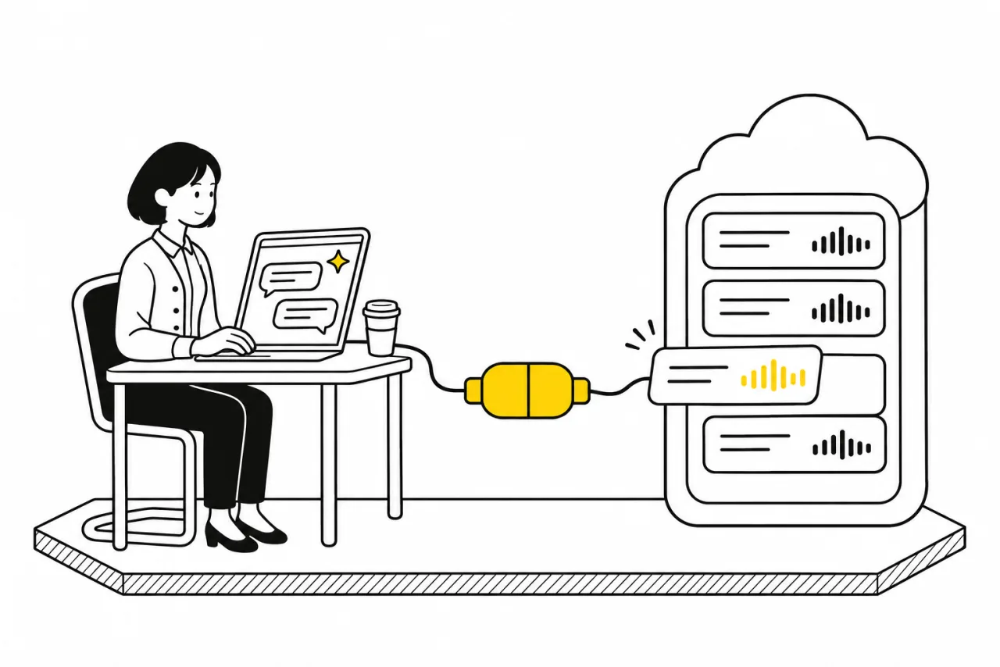

English | [한국어](README.ko.md) | [日本語](README.ja.md)

# Minu MCP

<p align="center"></p>

**Ask your AI assistant about your meetings.** Connect it to [Minu](https://minu.page), the AI meeting-notes service, and it reads your meetings, transcripts and minutes where you already work.

- "What did we decide in last week's meetings?"
- "Read the minutes of my last meeting and turn the action items into a checklist."
- "Make a Minu preset for my line of work."

Your assistant can read and can create presets. It cannot edit or delete your meetings.

> **Status.** Minu MCP is not open to everyone yet. If the sign-in page says it is unavailable, try again later.

## What you can do

Once connected, your assistant can use five tools on your Minu account.

| Tool | What it does |
| --- | --- |
| `list_meetings` | Lists your meetings, newest first. You can filter by words, dates or preset. |
| `get_meeting` | Reads the transcript of one meeting. |
| `get_meeting_minutes` | Reads the AI minutes of one meeting in the language you ask for. |
| `list_presets` | Lists your meeting presets. |
| `create_preset` | Creates a meeting preset from your topic, field and special terms. Up to 10 an hour. |

Your assistant cannot change or delete meetings, transcripts or minutes.

## What you need

- A Minu account on a paid plan (**Pro** or **Pro Plus**). On the Free plan, Minu shows a notice instead of connecting.
- One of the clients below.

| Client | Tested version |
| --- | --- |
| Claude Code | 2.1.325 |
| Codex CLI | 0.167.0 |

Other MCP clients have not been tested yet.

Server address:

```
https://api.minu.page/v1/mcp
```

## Connect Claude Code

1. In your project folder, add the server.

   ```bash
   claude mcp add --transport http --scope project minu "https://api.minu.page/v1/mcp"
   ```

2. Start `claude` in that folder and approve the new server when it asks.
3. Type `/mcp`, choose `minu`, then choose `Authenticate`.
4. Your browser opens the Minu sign-in page. The Minu pages are in Korean for now. Sign in, check the app name on the consent page, and press 허용 (Allow). The page may also name the app maker's site, such as claude.ai or chatgpt.com. That is expected. The first time you sign in to Minu on the web, a notice appears once before the consent page. Press 동의하고 계속하기 (Agree and continue).
5. Claude Code shows `Authentication successful. Connected to minu.` Try a request from [Try it](#try-it).

## Connect Codex CLI

1. Add the server. Codex starts the sign-in by itself.

   ```bash
   codex mcp add minu --url https://api.minu.page/v1/mcp
   ```

2. Your browser opens the Minu sign-in page. The Minu pages are in Korean for now. Sign in, check the app name on the consent page, and press 허용 (Allow). The page may also name the app maker's site, such as claude.ai or chatgpt.com. That is expected. The first time you sign in to Minu on the web, a notice appears once before the consent page. Press 동의하고 계속하기 (Agree and continue).
3. Codex prints `Successfully logged in.` Try a request from [Try it](#try-it).

To sign in again later:

```bash
codex mcp login minu
```

## Try it

- "List my Minu meetings from this week."
- "Read the minutes of my last meeting and turn the action items into a checklist."
- "Create a Minu preset for my work." Your assistant may ask about your field and terms first. Check the values it proposes, and approve the tool if your client asks.

## Disconnect

**Claude Code.** Type `/mcp`, choose `minu`, then choose `Clear authentication`. This ends the connection on the Minu side too. To remove the server from the project:

```bash
claude mcp remove --scope project minu
```

**Codex CLI.**

```bash
codex mcp logout minu
codex mcp remove minu
```

Codex removes the sign-in from your computer only. The connection on the Minu side stays until it expires, up to 30 days after its last use.

**From Minu.** To end a connection on the Minu side, open Settings in Minu on the web, go to 회의록 연결 (Minutes connections), find 연결된 AI 앱 (Connected AI apps), and press 연결 끊기 (Disconnect). This works for both clients. The section appears only when you have a connection.

## If it does not work

| You see | What to do |
| --- | --- |
| The sign-in page says Minu MCP is unavailable | Minu MCP is not open to everyone yet. Try again later. |
| A plan notice after sign-in, or the assistant says Minu MCP needs the Pro plan | Minu MCP needs a paid plan. Upgrade in the Minu app. |
| The assistant says you need to sign in again, or `Authentication required` | Claude Code: `/mcp`, `minu`, `Authenticate`. Codex CLI: `codex mcp login minu`. This also happens after you disconnect. |
| `create_preset` is refused | You can create up to 10 presets an hour. Try again later. |

## Help

Minu website: [minu.page](https://minu.page)

## Who makes Minu

Minu is made by WONDERMOVE, the company behind [ClawPod](https://www.clawpod.cloud/en/). With ClawPod you build a team of AI employees, delegate the work, and review the results. These teams are built with it.

- [AI Salesforce Maintenance & Operations](https://www.clawpod.cloud/en/salesforce-operations): finds the hidden cause behind a symptom and verifies the recovery.
- [AI Security Operations (SOC) Team](https://www.clawpod.cloud/en/security-operations): watches the logs from your existing security equipment around the clock.
- [Lance Penetration Testing](https://www.clawpod.cloud/penetration-testing) (Korean): finds weak points from an attacker's view and shows the evidence.
