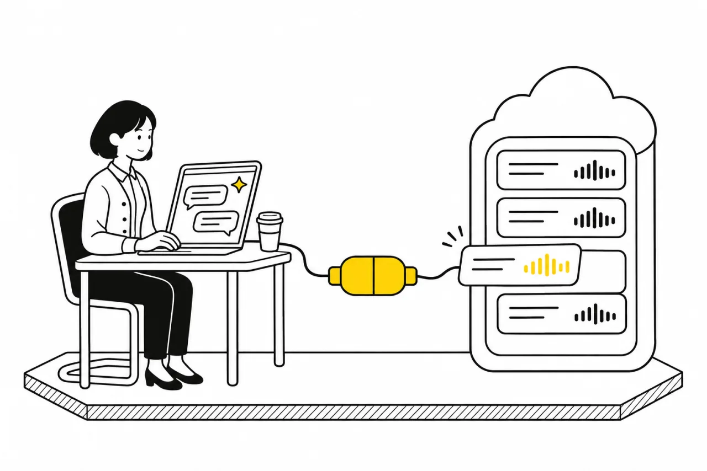

[English](README.md) | [한국어](README.ko.md) | [日本語](README.ja.md) | ไทย

# Minu MCP

<p align="center"></p>

**ถามผู้ช่วย AI เรื่องการประชุมของคุณได้เลย** เชื่อมต่อผู้ช่วยกับ [Minu](https://minu.page) บริการบันทึกการประชุมด้วย AI แล้วผู้ช่วยจะอ่านข้อมูลการประชุม ข้อความถอดเสียง และบันทึกการประชุมของคุณได้ในที่ที่คุณทำงานอยู่แล้ว

- "การประชุมเมื่อสัปดาห์ที่แล้วตกลงอะไรกันไว้บ้าง"
- "อ่านบันทึกการประชุมครั้งล่าสุด แล้วสรุปรายการงานที่ต้องทำต่อให้เป็นเช็กลิสต์"
- "สร้างพรีเซ็ต Minu ให้เหมาะกับงานของฉัน"

ผู้ช่วยอ่านข้อมูลและสร้างพรีเซ็ตได้ แต่แก้ไขหรือลบการประชุมของคุณไม่ได้

> **สถานะ** Minu MCP ยังไม่เปิดให้ทุกคนใช้งาน หากหน้าเข้าสู่ระบบแจ้งว่ายังใช้งานไม่ได้ โปรดลองอีกครั้งภายหลัง

## สิ่งที่ทำได้

เมื่อเชื่อมต่อแล้ว ผู้ช่วยจะใช้เครื่องมือ 5 รายการกับบัญชี Minu ของคุณได้

| เครื่องมือ | หน้าที่ |
| --- | --- |
| `list_meetings` | แสดงรายการประชุมของคุณ เรียงจากใหม่ไปเก่า กรองด้วยคำค้น วันที่ หรือพรีเซ็ตได้ |
| `get_meeting` | อ่านข้อความถอดเสียงของการประชุม 1 รายการ |
| `get_meeting_minutes` | อ่านบันทึกการประชุมจาก AI ของการประชุม 1 รายการ ในภาษาที่คุณขอ |
| `list_presets` | แสดงรายการพรีเซ็ตการประชุมของคุณ |
| `create_preset` | สร้างพรีเซ็ตการประชุมจากหัวข้อ สาขางาน และศัพท์เฉพาะของคุณ สร้างได้สูงสุด 10 รายการต่อชั่วโมง |

ผู้ช่วยเปลี่ยนแปลงหรือลบการประชุม ข้อความถอดเสียง หรือบันทึกการประชุมไม่ได้

## สิ่งที่ต้องมี

- บัญชี Minu ที่ใช้แพ็กเกจแบบชำระเงิน (**Pro** หรือ **Pro Plus**) หากใช้แพ็กเกจ Free ทาง Minu จะแสดงข้อความแจ้งแทนการเชื่อมต่อ
- ไคลเอนต์อย่างใดอย่างหนึ่งด้านล่าง

| ไคลเอนต์ | เวอร์ชันที่ทดสอบแล้ว |
| --- | --- |
| Claude Code | 2.1.325 |
| Codex CLI | 0.167.0 |

ยังไม่ได้ทดสอบกับไคลเอนต์ MCP อื่น

URL ของเซิร์ฟเวอร์:

```
https://api.minu.page/v1/mcp
```

## เชื่อมต่อ Claude Code

1. เพิ่มเซิร์ฟเวอร์ในโฟลเดอร์โปรเจกต์ของคุณ

   ```bash
   claude mcp add --transport http --scope project minu "https://api.minu.page/v1/mcp"
   ```

2. เรียกใช้ `claude` ในโฟลเดอร์นั้น จะมีคำถาม 2 ข้อขึ้นมาต่อกัน หากกด Enter อย่างเดียวจะได้คำตอบเริ่มต้น ซึ่งจะปิด Claude Code หรือเปิดใช้งานโดยไม่เชื่อมต่อ Minu โปรดใช้ปุ่มลูกศรเลือกดังนี้
   - เมื่อถามว่าเชื่อถือโฟลเดอร์นี้หรือไม่: `Yes, I trust this folder`
   - เมื่อถามถึงเซิร์ฟเวอร์ MCP ใหม่: `Use this MCP server`
3. พิมพ์ `/mcp` เลือก `minu` แล้วเลือก `Authenticate` หากเบราว์เซอร์ไม่เปิดขึ้นมา ให้กด `c` เพื่อคัดลอก URL สำหรับเข้าสู่ระบบ แล้ววางในเบราว์เซอร์ หากคัดลอก URL จากหน้าจอด้วยตนเอง URL อาจขาดตรงจุดที่ตัดขึ้นบรรทัดใหม่
4. เบราว์เซอร์จะเปิดหน้าเข้าสู่ระบบของ Minu ตอนนี้หน้าของ Minu ยังเป็นภาษาเกาหลี โปรดเข้าสู่ระบบ ตรวจสอบชื่อแอปในหน้าขอความยินยอม แล้วกด 허용 (อนุญาต) หน้านี้อาจแสดงเว็บไซต์ของผู้พัฒนาแอปด้วย เช่น claude.ai หรือ chatgpt.com ซึ่งเป็นเรื่องปกติ ครั้งแรกที่เข้าสู่ระบบ Minu บนเว็บ จะมีข้อความแจ้งขึ้นมาหนึ่งครั้งก่อนถึงหน้าขอความยินยอม ให้กด 동의하고 계속하기 (ยอมรับและดำเนินการต่อ)
5. Claude Code จะแสดง `Authentication successful. Connected to minu.` ลองใช้คำขอตัวอย่างในหัวข้อ [ลองใช้งาน](#ลองใช้งาน)

## เชื่อมต่อ Codex CLI

1. เพิ่มเซิร์ฟเวอร์ Codex จะเริ่มขั้นตอนเข้าสู่ระบบให้เอง

   ```bash
   codex mcp add minu --url https://api.minu.page/v1/mcp
   ```

2. เบราว์เซอร์จะเปิดหน้าเข้าสู่ระบบของ Minu ตอนนี้หน้าของ Minu ยังเป็นภาษาเกาหลี โปรดเข้าสู่ระบบ ตรวจสอบชื่อแอปในหน้าขอความยินยอม แล้วกด 허용 (อนุญาต) หน้านี้อาจแสดงเว็บไซต์ของผู้พัฒนาแอปด้วย เช่น claude.ai หรือ chatgpt.com ซึ่งเป็นเรื่องปกติ ครั้งแรกที่เข้าสู่ระบบ Minu บนเว็บ จะมีข้อความแจ้งขึ้นมาหนึ่งครั้งก่อนถึงหน้าขอความยินยอม ให้กด 동의하고 계속하기 (ยอมรับและดำเนินการต่อ) หากกด 거부 (ปฏิเสธ) หรือแพ็กเกจของคุณใช้ Minu MCP ไม่ได้ Codex จะเปิดหน้าเดิมขึ้นมาอีกครั้ง ให้กด 거부 อีกครั้งหรือปิดหน้านั้น
3. Codex จะแสดง `Successfully logged in.` ลองใช้คำขอตัวอย่างในหัวข้อ [ลองใช้งาน](#ลองใช้งาน)

หากต้องการเข้าสู่ระบบอีกครั้งในภายหลัง:

```bash
codex mcp login minu
```

## ลองใช้งาน

- "แสดงรายการประชุม Minu ของฉันในสัปดาห์นี้"
- "อ่านบันทึกการประชุมครั้งล่าสุด แล้วสรุปรายการงานที่ต้องทำต่อให้เป็นเช็กลิสต์"
- "สร้างพรีเซ็ต Minu สำหรับงานของฉัน" ผู้ช่วยอาจถามถึงสาขางานและศัพท์ที่ใช้ก่อน ตรวจสอบค่าที่ผู้ช่วยเสนอ และอนุมัติการใช้เครื่องมือหากไคลเอนต์ถาม

## ยกเลิกการเชื่อมต่อ

**Claude Code** พิมพ์ `/mcp` เลือก `minu` แล้วใช้ปุ่มลูกศรเลือก `Clear authentication` (รายการที่สาม) การเชื่อมต่อฝั่ง Minu จะสิ้นสุดลงด้วย หากต้องการลบเซิร์ฟเวอร์ออกจากโปรเจกต์:

```bash
claude mcp remove --scope project minu
```

**Codex CLI**

```bash
codex mcp logout minu
codex mcp remove minu
```

คำสั่งเหล่านี้ลบข้อมูลการเข้าสู่ระบบออกจากคอมพิวเตอร์ของคุณเท่านั้น ไม่ได้สิ้นสุดการเชื่อมต่อฝั่ง Minu การเชื่อมต่อจะยังอยู่จนกว่าจะหมดอายุ ซึ่งนานไม่เกิน 30 วันหลังการใช้งานครั้งล่าสุด หากต้องการสิ้นสุดทันที ให้ทำตามหัวข้อ **จากฝั่ง Minu** ด้านล่างด้วย

**จากฝั่ง Minu** หากต้องการสิ้นสุดการเชื่อมต่อฝั่ง Minu ให้เปิดหน้าตั้งค่าใน Minu บนเว็บ ไปที่ 회의록 연결 (การเชื่อมต่อบันทึกการประชุม) หา 연결된 AI 앱 (แอป AI ที่เชื่อมต่อ) แล้วกด 연결 끊기 (ยกเลิกการเชื่อมต่อ) วิธีนี้ใช้ได้กับทั้งสองไคลเอนต์ ส่วนนี้จะแสดงเฉพาะเมื่อมีการเชื่อมต่ออยู่

## หากใช้งานไม่ได้

| สิ่งที่เห็น | สิ่งที่ต้องทำ |
| --- | --- |
| หน้าเข้าสู่ระบบแจ้งว่า Minu MCP ยังใช้งานไม่ได้ | Minu MCP ยังไม่เปิดให้ทุกคนใช้งาน โปรดลองอีกครั้งภายหลัง |
| มีข้อความแจ้งเรื่องแพ็กเกจหลังเข้าสู่ระบบ หรือผู้ช่วยบอกว่า Minu MCP ต้องใช้แพ็กเกจ Pro | Minu MCP ต้องใช้แพ็กเกจแบบชำระเงิน โปรดอัปเกรดในแอป Minu |
| `OAuth error: access_denied` | คุณกด 거부 (ปฏิเสธ) หรือแพ็กเกจของคุณใช้ Minu MCP ไม่ได้ หากต้องการเชื่อมต่อ โปรดเข้าสู่ระบบอีกครั้งแล้วกด 허용 (อนุญาต) หากใช้แพ็กเกจ Free โปรดอัปเกรดในแอป Minu ก่อน |
| ผู้ช่วยบอกว่าต้องเข้าสู่ระบบอีกครั้ง หรือแสดง `Authentication required` | สำหรับ Claude Code: `/mcp`, `minu`, `Authenticate` สำหรับ Codex CLI: `codex mcp login minu` กรณีนี้เกิดขึ้นได้เช่นกันหลังยกเลิกการเชื่อมต่อ |
| `create_preset` ถูกปฏิเสธ | สร้างพรีเซ็ตได้สูงสุด 10 รายการต่อชั่วโมง โปรดลองอีกครั้งภายหลัง |

## ความช่วยเหลือ

เว็บไซต์ Minu: [minu.page](https://minu.page)

## ผู้พัฒนา Minu

Minu พัฒนาโดย WONDERMOVE บริษัทผู้สร้าง [ClawPod](https://www.clawpod.cloud/en/) ClawPod ช่วยให้คุณสร้างทีมพนักงาน AI มอบหมายงาน และตรวจผลงานได้ ทีมด้านล่างนี้สร้างด้วย ClawPod

- [AI Salesforce Maintenance & Operations](https://www.clawpod.cloud/en/salesforce-operations): หาสาเหตุที่ซ่อนอยู่เบื้องหลังอาการที่เกิดขึ้น และตรวจสอบผลการกู้คืน
- [AI Security Operations (SOC) Team](https://www.clawpod.cloud/en/security-operations): เฝ้าดูล็อกจากอุปกรณ์ความปลอดภัยที่คุณมีอยู่แล้วตลอด 24 ชั่วโมง
- [Lance Penetration Testing](https://www.clawpod.cloud/penetration-testing) (ภาษาเกาหลี): หาจุดอ่อนจากมุมมองของผู้โจมตีและแสดงหลักฐาน
